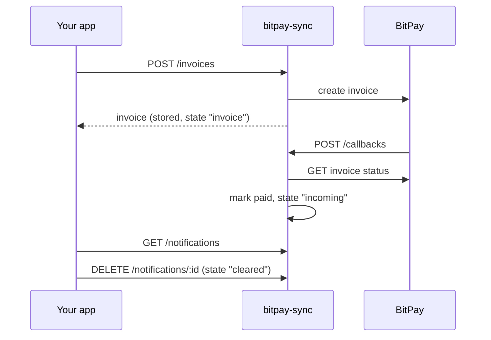

# Bitpay Sync

A small Node.js service that creates BitPay invoices, stores them in a database and marks them paid when BitPay calls back.

> [!NOTE]
> Dormant since January 2015. Built on the `bridges` framework with 2015 dependencies (`knex` 0.7, `bookshelf` 0.7, `gulp` 3, `6to5`) and untested on current Node. Not run in the 2026 docs pass.

## What it does

- `POST /invoices` creates an invoice at BitPay (through `bitpay-invoice-generator`) and stores it. The amount must be at least 0.01.
- `POST /callbacks` receives BitPay's notification and, if the invoice is confirmed, marks it paid.
- `GET /notifications` lists paid invoices that have not been cleared; `DELETE /notifications/:id` clears one.

## How it works



An invoice moves through the states `invoice`, `incoming` and `cleared` (`src/models/invoice.js`). Routes are declared in `src/config/routes.js`; the server is wired in `src/processes/server.js` and listens on `PORT` (default 5000).

## Getting started

Needs Node.js, Postgres and a BitPay API key. Set these environment variables (names only):

```
BITPAY_API_KEY
BITPAY_NOTIFICATION_URL

DATABASE_DIALECT
DATABASE_HOST
DATABASE_NAME
DATABASE_USER
DATABASE_PASSWORD
DATABASE_PORT     # listed in the original README; not read by the code
PORT              # optional, default 5000
```

```sh
npm install
npm run db:create    # runs psql via sudo -u $USER
npm run db:migrate   # knex migrations in src/migrations
npm start            # builds with gulp, then node build/bridges
npm test             # builds, then mocha on build/test
```

Source is in `src/` and compiled with 6to5 into `build/` (git-ignored).

## API

| Method | Path | Body or result |
|---|---|---|
| `POST` | `/invoices` | `{ amount, data }` returns `{ success, invoice }` |
| `GET` | `/invoices/:id` | `{ success, invoice }` |
| `POST` | `/callbacks` | BitPay notification payload |
| `GET` | `/notifications` | `{ success, notifications }` (paid, not cleared) |
| `DELETE` | `/notifications/:id` | `{ success, notification }` |

## Project history

Written on 2015-01-18 in nine commits over about four hours: store and track invoices, migrations, routes, BTC paid fix, minimum amount, status verification, then rename payments to notifications. Last version `0.2.3`. No commits since.

## License

ISC, as declared in `package.json`. There is no `LICENSE` file.
